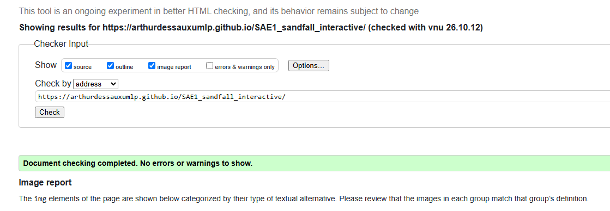
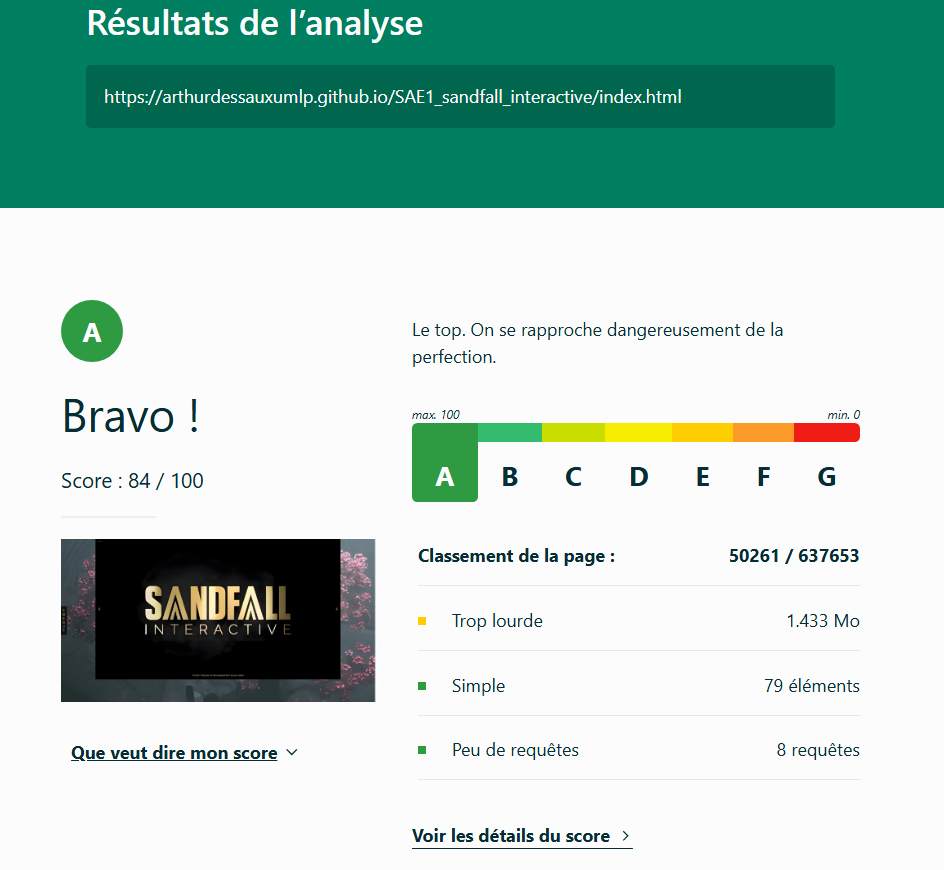

# Groupe 5 

## Site vitrine pour Sandfall Interactive

[S1 SAE1 Sandfall Interactive](https://arthurdessauxumlp.github.io/SAE1_sandfall_interactive/)

## Membres du groupe 5 :

Etudiant 1 (référent du groupe) : [Ilias CHELLAH](mailto:ilias.chellah@edu.univ-fcomte.frr?subject=SAE_1_05_06)  
Etudiant 2 : [DESSAUX Arthur](mailto:arthur.dessaux@edu.univ-fcomte.fr?subject=SAE_1_05_06)   
Etudiant 3 : [Tom CREUSOT DUC](mailto:tom.creusot_duc@edu.univ-fcomte.fr?subject=SAE_1_05_06)  
Etudiant 4 : [Adriana SUAREZ OVIEDO](mailto:adriana.suarez_oviedo@edu.univ-fcomte.fr?subject=SAE_1_05_06)  
Etudiant 5 : [Rokhaya FALL](mailto:rokhaya.fall@edu.univ-fcomte.fr?subject=SAE_1_05_06) 

## Présentation du projet

Ce dépôt correspond à un site web créé en HTML/CSS/JS dans le cadre de la SAÉ 05-06 à l'IUT de Belfort-Montbéliard.
Le projet consiste à faire un site vitrine pour l'entreprise Sandfall Interactive.
**(https://www.sandfall.co/)**
Ce site apportera plusieurs sujets sur l'entreprise que nous mettrons en avant en corrélation avec la demande du client.

## Choix de conception  

Pour la conception du site, nous nous sommes grandement inspirés du site officiel de Sandfall Interactive (disponible [ici](https://www.sandfall.co/)). Puis nous avons établis les 5 différentes pages à faire en fonction de nos préférences.

## Développement Site Web et Validation des pages

### Page d'accueil

**Auteur : FALL Rokhaya**  

Vérification W3C : [Liens vers le validateur](https://validator.w3.org/nu/?showsource=yes&showoutline=yes&showimagereport=yes&doc=https%3A%2F%2Farthurdessauxumlp.github.io%2FSAE1_sandfall_interactive%2F)

## Répartition du travail

### Planification - Diagramme de GANTT

- DESSAUX Arthur

### Recherches d'informations

- FALL Rokhaya
- SUAREZ OVIEDO Adriana

### Développement site

- FALL Rokhaya
    Page d’Accueil
- CHELLAH Ilias
    Page Histoire
- CREUSOT DUC Tom
    Page Mieux nous connaître
- SUAREZ OVIEDO Adriana
    Page Économie
- DESSAUX Arthur 
    Page Identité artistique et culturelle    
